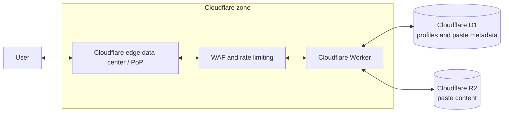

# sosi.lol


A lightweight paste service running on Cloudflare Workers. Paste content is stored in Cloudflare R2, while paste IDs, profile data, and object keys are stored in Cloudflare D1. Sign in with GitHub to associate pastes with your profile.

Try it at [cf.sosi.lol](https://cf.sosi.lol).

## Architecture



## Deploying

You need a Cloudflare account, [Bun](https://bun.sh/), Rust with the `wasm32-unknown-unknown` target, and `worker-build` 0.9. Cloudflare may require a supported payment card to create an R2 bucket, depending on your account and region.

1. Install the frontend dependencies, then create a D1 database:

   ```sh
   bun install --frozen-lockfile
   bunx wrangler d1 create pastes
   ```

   Put the returned database ID in `database_id` in `wrangler.toml`. The `DB` binding is already configured.

2. Apply the migrations to the remote database:

   ```sh
   bunx wrangler d1 migrations apply pastes --remote
   ```

3. Create the R2 bucket named in the `BUCKET` binding:

   ```sh
   bunx wrangler r2 bucket create pastes
   ```

4. Generate a base64-encoded 64-byte `COOKIE_KEY`. Paste the output when Wrangler prompts for `COOKIE_KEY` (or use it as the value in `.dev.vars`):

   Bash:

   ```sh
   openssl rand -base64 64
   ```

   PowerShell:

   ```powershell
   $bytes = New-Object byte[] 64
   [Security.Cryptography.RandomNumberGenerator]::Create().GetBytes($bytes)
   [Convert]::ToBase64String($bytes)
   ```

5. Set the Worker secrets using the names in `.dev.vars.example`:

   ```sh
   bunx wrangler secret put COOKIE_KEY
   bunx wrangler secret put GITHUB_CLIENT_ID
   bunx wrangler secret put GITHUB_CLIENT_SECRET
   bunx wrangler secret put GITHUB_REDIRECT_URL
   ```

   Set the GitHub OAuth application's callback URL to the value of `GITHUB_REDIRECT_URL`, such as `https://cf.sosi.lol/auth/redirect`.

6. Build the frontend assets, then deploy the Worker:

   ```sh
   bun run build
   bunx --no-install wrangler deploy
   ```

Wrangler reads migrations from the root `migrations/` directory. For local development, copy `.dev.vars.example` to `.dev.vars` and fill in the secrets. Run `bun run dev` to watch and rebuild the frontend assets.

Set `MAX_PASTE_SIZE_BYTES` in the `[vars]` section of `wrangler.toml` to change the paste limit. The default is `65536` bytes (64 KiB).

## Suggested Cloudflare WAF rate limits

The [Go implementation](https://github.com/SegfaultSommeliers/sosilol) applies these per-IP limits. Use them as starting thresholds for Cloudflare rate-limiting rules:

| Scope | Limit |
| --- | --- |
| All requests | 60 requests per minute |
| `POST /save` | 10 requests per minute |
| `GET /auth/request` | 5 requests per minute |

Count requests by client IP and adjust the thresholds and action for your deployment.

## Licenses and attribution

The project is licensed under the [MIT License](LICENSE-MIT) or the [Apache License, Version 2.0](LICENSE-APACHE), while certain UI components are licensed under the [MIT License](LICENSE-UPSTREAM). By submitting a pull request, you agree that your contributions are provided under these licenses.

This repository complies with REUSE.
